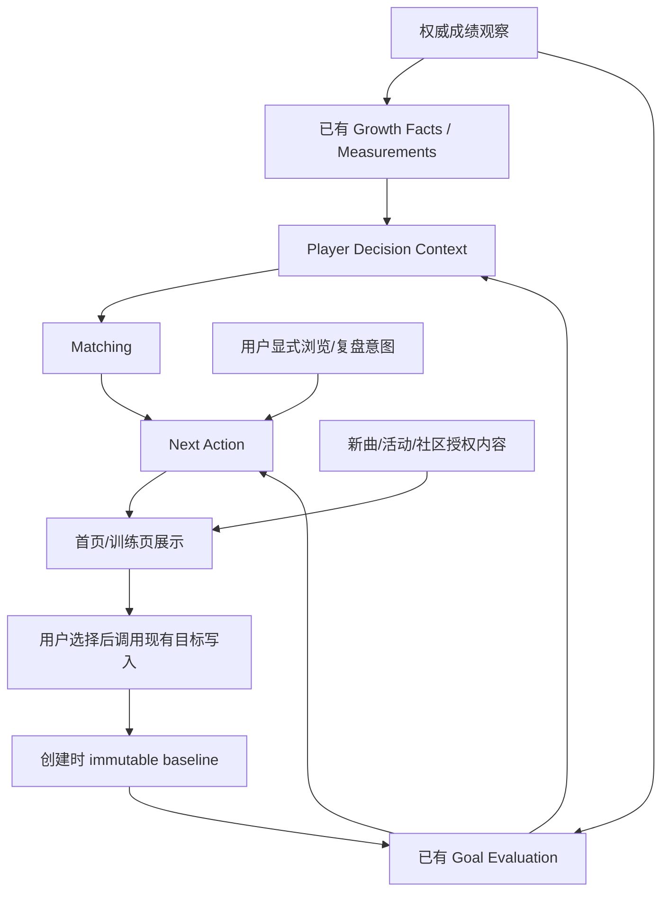

# Goal / Recommendation / Training / Living Home

## 依赖图

从 Next Action 到事实没有直接写路径。点击、曝光、选择、排队、取消、实际游玩、成绩观察和目标评价是不同事件；只有最后的权威链路可以提供完成证据。

## 单活动目标与 Next Action

当前 `writePlayerGoal` / `mutateGoal` / `expectedActiveGoalId` CAS 是单活动目标语义。普通推荐创建还校验 recommendationToken、scoreRevision、snapshot provenance、chart availability 和 manual lock；重试保留原 baseline。`evaluateGoal` 校验 owner/profile/chart、revision、provenance source/account/topology、时间/marker 顺序和 counter reset。这些职责保持原服务所有。

`projectNextAction` 只消费现有 GoalEvaluationResponse 和同 profile/score/catalog/asOf 的 MatchResult。它不创建新 Goal、不标完成、不迁移目标，不触发 API 或数据库：

| 状态 | 主动作 |
| --- | --- |
| 用户指定谱面 | inspect-chart 导航，不能表示算法已证明可达 |
| 身份/版本不符、缺评价、inconclusive、evaluation-error、矛盾状态 | refresh-evidence |
| 已完成且有原 completionEvidence | review-completed-goal，附合格下一步候选，等待用户决定 |
| 活动谱面已不可用 | resolve-unavailable-goal，不自动取消 |
| 活动目标 | review-active-goal，保留用户承诺；可见不等于重新证明可达 |
| 无活动目标且有合格推荐 | choose-next-goal |
| 无稳定合格候选 | insufficient-evidence |

Goal 只在已通过准入的候选中影响排序；score-pb 的候选门槛必须精确对应既有 `highScore > baseline.highScore`，并校验 targetData 字段、方向和可选比较值；具体整数门槛规则见 [匹配合同](matching-benchmark.md)。FC/DF 等继续由既有 evaluator 处理，不能因同谱面挂上 score-pb 排序理由。完成后重新构造 context/matching，再让用户选择下一目标，不能沿用完成前 receipt 或自动续订。

多目标现在不伪装成已支持。保留一个活动目标和最多三个可重建建议；这不是持久 Training Queue。未来有明确需求时可新增唯一的用户计划意向集合（排序/移除/收藏），其中每项只引用 chart/目标意图，不包含另一个 active/completed 状态机。激活仍走现有 CAS。没有必要为了当前推荐建立队列数据库。

## Living Home 现在就参与设计与实现

现有 `pages/index.vue` 已通过 `useHomeContent` 加载 latestSongs、提供活动 slides，并分 guest/loading/public_error/authenticated。`components/rework/today/SignedIn.vue` 已同时消费 `usePlayerGrowth` 与 `useRecentGrowth`，通过 `HomePlayerGrowthSurface` 注入 LatestSongs/Events；社区内容已有 `components/rework/community/HomeSide.vue` / Today Feed 等组件。当前活动 slides 是页面静态资源与文案，不假定其已经有可维护活动日历 API。

本批实现 `projectLivingHome`，在离线 pure projection 中同时输出 Next Action、近期 fact 引用、长期原始投影和公共内容 ID；空推荐不会阻断新曲/活动/社区。这条接线无需等所有算法完成或外部 Agent 提供能力。

Review Fix 后，Home recent 直接保留 Context 的 `factSemantics`、`factReferences` 与 `sessionIdentifiability`，不再另称 observed-changes。每条引用的 occurredAt/observedAt/confirmedAt 独立保留；例如去年发生、今天确认的 PB，knownAt 可以是今天，但 occurredAt 仍是去年。不存在从确认时间推导今天游玩次数的路径。

下一候选阶段接线顺序：

1. 在已有账号读取链路中按同一 binding/publication scope 组装 context；已有 growth overview 可能持久化测量，不能被离线回放器偷偷调用。将读来源/knownAt 明确交给适配器。
2. 首页原异步区块保留各自 loading/error；Next Action 只是成长区域的投影。绑定切换、source change、score/catalog revision 更新时丢弃旧 context 和建议。
3. 近期成绩变化显示观察窗口与更新时刻；late-discovered PB 不称“今天训练”。长期 Rating 单独展示，不和近期百分比混合。
4. 新曲来自既有 catalog authority/availability 和实际发布日期资料；首次被本地看到不等于发行日。活动与社区保留现有内容授权、隐藏/屏蔽和链接行为；社区热度不成为能力证据。活动日期数据不足时不自动生成“进行中”断言。
5. 点击“下一目标”复用现有 GoalPicker/签名请求；要先检查 receipt 与当前 context，服务器仍作最终鉴权。点击不改变 dailyProgress、Recent acknowledged state 或 play count。

验收场景：guest、未绑定、空成绩、推荐不足、接口失败、完成目标、不可用目标、切换绑定、近期无事实、新曲有内容但推荐失败；每个公共区块独立可用，推荐不足可直接浏览谱面。后续 UI 接线需独立做 i18n/移动端/桌面/键盘验收并按仓库规则升版；本批不改生产 UI、不启动浏览器或 dev server。
