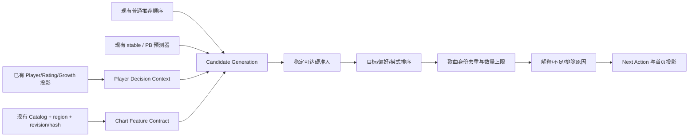

# Matching Architecture 与离线评估

## 匹配流程



`adapters.ts` 接受已有 `RecommendationToolPayload` 的原始顺序，以及既有 core `ChartScoreEstimate` 独立导出。读取 `song_id/level/current_score/reliability/data_sufficiency/stable.score/pb.score`；不复制预测算法。`inStrictRange` 从不作为 stable 替代；目标分数须显式提供，未提供的条目不生成候选。谱面和预测重复 identity 抛错，禁止 map 任意覆盖。

Chart Feature Contract 包括 `songId/difficultyType/key/identityGroup/catalogRevision/sourceHash/region/availability/star/genre/verifiedDimensions/evidenceRefs`。key 为精确谱面 ID，identityGroup 由已有 catalog 版本映射供给，不能按标题猜合并。genre 可空，verifiedDimensions 只接受现有已验证谱面字段。本阶段不推断谱面手法、音乐结构、Guide–Chart Alignment 或领域知识。

ReachEvidence 与 profile、scoreRevision、catalogRevision、sourceHash 和 chartKey 全部绑定。generatedAt/featureCutoff/modelVersion/evidenceRefs 必须存在。输入最多 5,000 candidates、K 1–50。离线 adapter 只处理已有普通入口最多 50 条，不声称全库召回；后续 Candidate Generation 可增加活动目标与 discovery catalog 分支，但都必须使用相同版本及 stable gate。缺特征不填假值。

## 准入与排序

实验准入策略 `viewer-stable-match/1`：active 且地区正确，完整 identity/hash/evidence，当前 V1 至少 20 样本，现有 stable 正分、dataSufficiency=ok、targetScore <= stableScore，confidence >= 0.6，featureCutoff 不早于 asOf 30 天，且 cutoff <= generated <= asOf。core reliability 0–100 仅线性换算为 confidence 0–1。这些是透明、可更换的候选实验阈值，不是已验证统计置信界，不是成功概率；stable 本身也不是经标注验证的保证。

只有 PB、低 confidence、未知/下架、版本漂移、不匹配地区、未来/过期证据、缺目标均不能用来补足推荐数。K 是上限；返回 requestedCount、eligibleCount、shortage、逐条排除原因。

| 模式 | 当前可支持的意图 | 边界 |
| --- | --- | --- |
| Skill Match | 已有普通排序 + stable gate | 指标接近不等于手法匹配 |
| Growth | 现有最低有效维度与已验证 chart dimension 相交后提序 | 不生成新的六维事实；Rating/Growth 冲突时不提序 |
| Goal | 同一活动 score-pb 目标/精确谱面提序 | FC/DF 不能用分数预测证明，维持原目标 evaluator |
| Discovery | 稳定池内未玩优先，显式偏好参与 | 未玩是当前权威成绩快照语义，不把未知当真实从未游玩 |
| Breakthrough | 已知 currentBestScore，target > currentBestScore 且 target <= stable | 只有 PB 估计不能支持推荐；零候选可接受 |

排序不计算第二个 Rating。先活动 goal，再显式 preference，再模式匹配，再已有 baselineRank，最终精确 key 保证确定性。`ranking=existing-order` 关闭新增提序；`contextual` 才加入上下文。两者均使用相同 stable gate 与 identityGroup 去重，最多同一歌曲身份一个谱面。多样性目前保证歌曲身份，不假称技能/音乐风格多样性；无足够 genre 信息明确报告 coverage。

Review Fix：Growth 提序要求 `growthConsistency=consistent`、对应维度的 `dimensionConsistency=consistent`、现有 Growth State 为 ready/lowest-valid-dimension，并且 chart 明确验证了同一维度。空/部分维度的全局状态为 unknown，不以空数组 `.every()` 的真值作为可信度。

Active Goal 由 `goal-target.ts` 的同一纯校验同时约束 adapter 标记与 matching 理由，不能仅凭相同 chart 或传入 goalId 提序。仅允许当前 profile 的 active、可用 score-pb Goal；targetData 必须为 `field=highScore, comparison=greater`，baseline 必须有非负安全整数 highScore。当前既有 evaluator 比较 `highScore > baseline.highScore`，而候选 targetScore 是包含等号的得分门槛，因此精确等价的整数门槛为 `baseline.highScore + 1`；高于或低于此门槛均不能标 active-goal。既有 score-pb 的 targetData 没有 value；若输入显式给出 value，它只能重述 baseline 比较值，不能与 evaluator 所用值不同。缺 baseline、越界、其他字段/方向/Goal 类型均不绑定；普通可达性可独立保留。没有改动原 Goal evaluator 或现行推荐算法。

解释提供 reasonCodes、target/stableScore、confidence、policyVersion 和原始 evidenceRefs；始终带无音乐/手法分析、confidence 不是成功概率的能力边界。后续 UI 用简短产品文案映射代码，不直接呈现本文规格文字。

## 评估协议 `viewer-offline/1`

数据输入 `BenchmarkDataset` 分离 decisions、plays、goals、priorExposures，固定 dataset revision/freezeAt。决策输入所有 feature 的 occurredAt 与 availableAt <= decisionAt；冻结目录、分数语义、预测器版本，不能使用今天数据补历史。标签必须在 `(decisionAt, decisionAt+7d]` 发生且 freezeAt 前可用。未成熟 7 天窗口单列排除，缺标签 unknown；不作失败断言。

实验稳定标签：固定最早两次 identifiable plays，两次均达到目标才算成功；仅用于验证评估器的保守测试协议，生产稳定标准仍需预注册。score MAE/概率校准使用最早一次游玩。最早符合时间窗口的曝光先认领，认领不看分数，playId 不能复用；重复 play ID 拒绝。点击/PB-only/snapshot/无证据/迟到未冻结数据不进逐次结果。一次判定所用 exposure 必须来自实际展示日志；候选生成不能冒充曝光。本批 synthetic replay 的曝光全为模拟。

| 指标 | 输出口径 | Unknown / unavailable |
| --- | --- | --- |
| Reachability Precision@K | confirmed / emitted 保守下界；confirmed / resolved 条件精度；resolved / emitted 标签覆盖 | 未满足两次真实标注的推荐 unknown；额外报告 requested slots 与实际 emitted |
| Actionable Coverage | 至少一个 actionable 的完整输入决策 / 完整输入决策；slotCoverage 独立 | 不完整输入不算失败；ordinary 无 stable/target 时输入不完整 |
| Score Prediction Error | first-play MAE、RMSE、predicted-actual bias | 无逐次标签或点预测为 null，不输出虚假 0 |
| Prediction Calibration | first-play 概率 Brier 与固定 5 bins | confidence 不可冒充概率；现有 ordinary 无概率则 unavailable |
| Recommendation Diversity | 不同歌曲配对 / 全部配对，跨 slate uniqueChartRatio，genre coverage | 少于两条不形成配对；不声称音乐技能多样性 |
| Repeat Rate | 14d 内同玩家同 chart 重复曝光 / 完整曝光历史的曝光 | priorExposures 需要 warmup 窗口；仅有本基准日志不自动完整 |
| Goal Progression | 去重 player/goal 的权威 completed / 有终点结论 goal；goal observation coverage | 已完成评价是终态；active 必须有窗口终点评价，较早 active 不证明终点未完成；不作因果归因 |

所有指标提供分母和 unknown，输入/标签排除另列；没有真实队列时不能宣称准确率。后台不写 exposure、play、goal 表。本批 fixture 是明确 synthetic，不含真实玩家身份。

## 基线与复现

`scripts/player_intelligence_baseline.py` 在已安装 Batch 2.1 core 上执行 existing `recommend_songs`，对照原合成 golden，保持普通排序/选择结果；并执行 core 的原 `test_recommendation.py`。保留 126 case 输出、fixture hash、core 版本、全部 core Python source hash、依赖版本。不是用新写启发式冒充旧算法。

`taiko_viewer/scripts/benchmark_player_intelligence.mjs` 将这份基线作为无真实标签的报告，同时独立运行 2-decision synthetic metric oracle。ordinary 本身没有 stable target/逐次标签，所以 Reachability 条件精度、MAE、calibration、Goal Progression 均不可用；不从 `inStrictRange` 或金样例一致性填充成功标签。首次真实比较需要分别报告：原始旧策略、原顺序+stable gate、contextual 排序，分离门槛与重排效果。

```bash
bash scripts/memory/run_qa.sh /var/tmp/taiko-batch21-20261124/installed-rc9/bin/python -I scripts/player_intelligence_baseline.py --core-tests /var/tmp/taiko-batch21-20261124/core/tests --output docs/batch3/evidence/existing-baseline.json
bash scripts/memory/run_qa.sh /www/server/nvm/versions/node/v24.13.0/bin/node --experimental-strip-types taiko_viewer/scripts/benchmark_player_intelligence.mjs docs/batch3/evidence/existing-baseline.json docs/batch3/evidence/offline-benchmark.json
```

可移植复现：使用证据中标识的 core 版本/源码 manifest 与两个 fixture hash，替换命令中的解释器与 core-tests 路径；不得指向生产资料目录。指标 JSON 不包含当前系统时间，重复运行可比较字节哈希。策略改动必须先更新协议版本和预注册阈值，不能在测试结果出来后悄悄调整。
