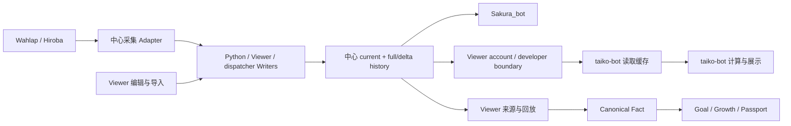

# Phase 0：数据流与 Writer 清单

2026-10-10。详细图与调用证据见 [原 data-flow-map](platform-architecture-audit/data-flow-map.md) 和 [data ownership](platform-architecture-audit/data-ownership-audit.md)。

| 对象 | 写入者 | 读取者 | 语义 |
| --- | --- | --- | --- |
| score/current userdata | 中心 Python Wahlap/Hiroba→save_userdata；Viewer manual/edit/Kinoko；dispatcher local publication；u0 merged 派生 | Sakura_bot、Viewer、developer API→taiko-bot cache | 平台最佳记录集合，可编辑，不是逐次游玩 |
| history full/delta | Python save_userdata；Viewer history/import；dispatcher；merged 派生 | Sakura/annual/trend、Viewer Growth/Goal、taiko-bot history cache | 状态观察和删除/变化证据，不自动证明发生过游玩 |
| userdata cache | taiko-bot userdata_provider | taiko-bot 本地算法/图片 | 可重新取得，无中心 writer 权限 |
| daily ability | Python snapshot/post-publication archive | Sakura trend、Viewer Passport | 历史测量，过去日冻结；不能当可丢弃 cache |
| SQL measurement | Viewer Growth overview 条件写入 | Viewer history/weekly/passport | 带模型/输入版本的当时能力测量 |
| Canonical Fact | Viewer replay/evidence→projectScoreFacts；Goal lifecycle/evaluation | recent/history/weekly/passport | 基于来源规则的推导事实；当前主要请求期生成 |
| user / binding | Viewer Web MySQL；中心 bot bind；manual ownership；QQ linking | 对应 authorized adapter | 命名空间、绑定槽位与归属不可按字符串自动合并 |

风险仍需处理：developer token 是配额身份而不是资源授权；current/history 当前无共同跨 Writer commit；中心运行树与仓库 dispatch 有差异。Phase 0 不修改这些行为，不宣称线上利用/丢失已发生。Phase 5 建立授权读取与事实边界，Phase 6 统一 publication/recovery，再决定 DB 是否必要。
