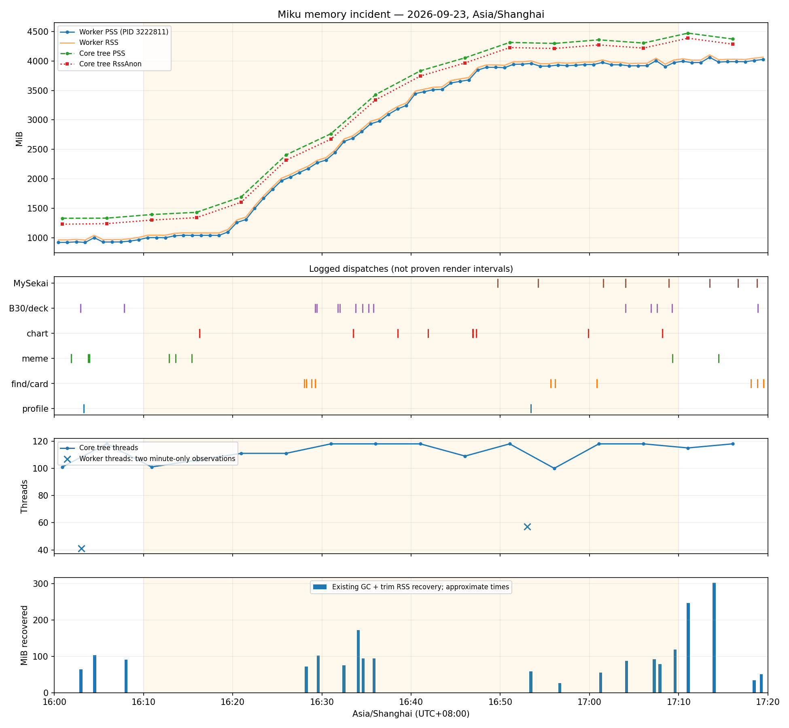

# Miku memory incident — 2026-09-23 16:10–17:10 Asia/Shanghai

**Final status: INSUFFICIENT HISTORICAL EVIDENCE.** The growing process is identified with high confidence: Python worker **3222811**, PPID **3222718**, started **12:56:44**. The responsible workload/allocation owner is not established. Do not read this status as uncertainty about which process grew.

Worker PSS increased **1002.93 → 3994.78 MiB**, **+2991.85 MiB (2.922 GiB)**, at actual sample times **16:10:27 → 17:10:28**. RSS increased 1043.35 → 4037.42 MiB. Most growth was 16:19–16:48; it persisted through 17:20 and the surviving worker's later read-only inspection. No restart, kill, profiler attachment, forced GC, new trim, cache clear or workload replay was performed against this worker.

## Evidence and timing rules

Window for samples: **[16:00,17:20]**; exact workload aggregation: **[16:10:00,17:10:00)**, UTC+08:00. Logs resolve to seconds; native minute metrics resolve only to the minute. Neither is silently interpolated to exact measurement times.

Private collected evidence and analysis scripts: `/var/tmp/miku-incident-20260923-1610/` (0700). `/proc` copies were captured at approximately **19:16**; they describe the surviving process then, not its 17:10 mappings. Source evidence:

- `/var/log/taiko-memory/2026-09-23.jsonl`: 80 worker and 80 master PSS/RSS/swap samples, nominally one minute apart. Fifteen-second host records do **not** imply fifteen-second per-process samples.
- `/var/lib/sakura-render/observations/phase1-memory-20260923.jsonl`: 16 core-tree and 16 separate Rust-service-tree samples, nominally five minutes apart; process lists, aggregate RSS/PSS/RssAnon/swap/threads.
- `/home/sigaer/miku-bot/runtime/gateway-core/logs/core.log`: matcher dispatches, scheduler warnings, trace metadata, 20 existing cleanup samples in the wider window (13 inside the incident hour). Raw request/chat content was neither copied nor included in derived artifacts.
- `runtime/native-render-metrics/native-path-a-20260923T1603.json` and `...T1653.json`: two additional worker memory/thread observations and profile route counts. Files have no PID or exact sample second; assignment to the sole unchanged worker is an inference.
- `/var/log/python-memory/miku-core/3222811.json`: **current snapshot only**. `runtime_memory/metrics.py` atomically replaces this file every minute; it is not a historical cache series.
- systemd journal for 16:00–17:20, current `/proc` start ticks/parent tree, deployed scheduler/renderer source. Previous phase-3/4 reports concern older cohorts and are **not incident attribution evidence**.

[All available process/tree/cleanup samples, KiB CSV](miku-memory-incident-20260923-1610/samples.csv) · [Minute workload counts](miku-memory-incident-20260923-1610/workloads.csv) · [All cleanup measurements](miku-memory-incident-20260923-1610/trim.csv)

Blank CSV fields mean **unrecorded**, never zero. Historical per-worker RssAnon/RssFile, threads and CPU cannot be filled from the host monitor. Native snapshots supply RssAnon/threads twice only; tree samples cannot be relabeled worker samples. RSS minus RssAnon includes file **and shmem**, so it is not reported as exact RssFile. No historical per-process CPU counters were located; host CPU is not substituted.

## Process identity at the four requested times

| Requested time | Evidence nearest target | Master → worker | Replacement evidence |
| --- | --- | --- | --- |
| 16:10 | Host 16:10:27; observer 16:10:54 | 3222718 → 3222811 | None |
| 16:30 | Host 16:30:27; observer 16:25:58 / 16:31:00 | 3222718 → 3222811 | None |
| 17:00 | Host 17:00:28; observer 16:56:03 / 17:01:03 | 3222718 → 3222811 | None |
| 17:10 | Host 17:10:28; observer 17:06:03 / 17:11:03 | 3222718 → 3222811 | None |

The following eight PIDs occur unchanged in every observer tree sample. Their current start timestamps precede the incident, independently checking PID continuity. Parent/role assignments come from surviving `/proc` metadata; historical observer lists alone do not store PPID. Exact instantaneous trees at 16:10:00 etc. were not recorded; short-lived children between samples remain possible.

| PID | PPID | Start (2026-09-23 CST) | Role |
| --- | --- | --- | --- |
| 3222718 | 1 | 12:56:38 | master |
| 3222810 | 3222718 | 12:56:44 | resource_tracker |
| 3222811 | 3222718 | 12:56:44 | worker |
| 3222848 | 3222811 | 12:56:49 | playwright_driver |
| 3222914 | 3222848 | 12:56:50 | browser |
| 3222916 | 3222914 | 12:56:50 | browser |
| 3222917 | 3222914 | 12:56:50 | browser |
| 3222933 | 3222916 | 12:56:50 | browser |

Tree: master → resource tracker + worker → Playwright driver → headless browser → two zygotes; PID 3222933 descends from zygote 3222916. Master PSS range during 16:00–17:20: **203.17–205.27 MiB**. A master replacement or several replicated workers does not explain this rise. The separately sampled Rust tree remains approximately 43–45 MiB PSS; it is not the growing Python PID.

## Memory shape and complete minute series

**CONTINUOUS_GROWTH**, at available minute resolution: sustained unequal increments during 16:19–16:48, then a roughly 3.9 GiB worker PSS plateau with transient excursions. The data do not support PROCESS_REPLACEMENT or a SINGLE_SPIKE. Sampling cannot distinguish smooth allocation from smaller sub-minute steps. “Large steps” below mean sampled increments, not proven single allocation events.

All worker minute samples below are PID 3222811, units MiB; VmSwap=0 for all 80. Worker RssAnon/RssFile/threads/CPU are unrecorded in this source, explicitly blank in the CSV. Master values are also preserved in the CSV.

| Time | RSS | PSS | Time | RSS | PSS |
| --- | --- | --- | --- | --- | --- |
| 16:00:27 | 965.02 | 922.78 | 16:40:28 | 3487.81 | 3445.67 |
| 16:01:27 | 964.76 | 922.56 | 16:41:28 | 3520.99 | 3478.85 |
| 16:02:27 | 973.34 | 931.60 | 16:42:28 | 3553.65 | 3511.59 |
| 16:03:27 | 961.67 | 921.38 | 16:43:28 | 3560.21 | 3518.18 |
| 16:04:27 | 1042.41 | 1002.02 | 16:44:27 | 3667.78 | 3625.82 |
| 16:05:27 | 968.79 | 928.43 | 16:45:28 | 3695.38 | 3653.42 |
| 16:06:26 | 969.49 | 929.12 | 16:46:28 | 3719.52 | 3677.56 |
| 16:07:27 | 970.51 | 930.15 | 16:47:28 | 3887.36 | 3845.40 |
| 16:08:27 | 984.45 | 944.02 | 16:48:27 | 3933.00 | 3892.54 |
| 16:09:27 | 1007.76 | 967.34 | 16:49:29 | 3933.00 | 3891.97 |
| 16:10:27 | 1043.35 | 1002.93 | 16:50:28 | 3926.17 | 3885.14 |
| 16:11:27 | 1043.40 | 1002.98 | 16:51:28 | 3984.34 | 3943.31 |
| 16:12:27 | 1043.85 | 1001.96 | 16:52:27 | 3985.91 | 3945.44 |
| 16:13:27 | 1075.57 | 1033.68 | 16:53:28 | 4000.56 | 3958.41 |
| 16:14:27 | 1085.04 | 1043.15 | 16:54:28 | 3954.03 | 3911.88 |
| 16:15:27 | 1083.07 | 1041.18 | 16:55:28 | 3954.77 | 3912.62 |
| 16:16:27 | 1083.18 | 1041.29 | 16:56:28 | 3972.98 | 3930.83 |
| 16:17:27 | 1082.11 | 1041.68 | 16:57:28 | 3962.07 | 3919.91 |
| 16:18:27 | 1082.59 | 1040.71 | 16:58:28 | 3969.34 | 3927.19 |
| 16:19:27 | 1141.00 | 1099.10 | 16:59:28 | 3981.67 | 3939.51 |
| 16:20:27 | 1301.91 | 1260.01 | 17:00:28 | 3981.71 | 3939.56 |
| 16:21:28 | 1351.73 | 1309.83 | 17:01:28 | 4017.46 | 3975.31 |
| 16:22:27 | 1540.55 | 1498.65 | 17:02:28 | 3977.52 | 3935.37 |
| 16:23:27 | 1711.19 | 1669.27 | 17:03:28 | 3977.55 | 3935.39 |
| 16:24:28 | 1864.38 | 1822.46 | 17:04:28 | 3957.82 | 3916.89 |
| 16:25:27 | 2011.12 | 1969.32 | 17:05:28 | 3961.30 | 3918.90 |
| 16:26:27 | 2072.69 | 2030.89 | 17:06:27 | 3961.61 | 3919.21 |
| 16:27:27 | 2149.14 | 2107.34 | 17:07:28 | 4046.77 | 4004.20 |
| 16:28:28 | 2216.69 | 2176.37 | 17:08:29 | 3945.48 | 3902.92 |
| 16:29:27 | 2313.96 | 2272.79 | 17:09:28 | 4015.25 | 3972.61 |
| 16:30:27 | 2360.03 | 2318.86 | 17:10:28 | 4037.42 | 3994.78 |
| 16:31:27 | 2487.40 | 2446.26 | 17:11:28 | 4013.74 | 3972.44 |
| 16:32:29 | 2676.89 | 2635.85 | 17:12:29 | 4014.96 | 3973.66 |
| 16:33:27 | 2729.57 | 2689.16 | 17:13:28 | 4102.89 | 4061.59 |
| 16:34:27 | 2843.96 | 2801.61 | 17:14:28 | 4021.01 | 3981.11 |
| 16:35:27 | 2976.82 | 2934.39 | 17:15:27 | 4027.77 | 3987.87 |
| 16:36:27 | 3021.62 | 2979.23 | 17:16:27 | 4028.24 | 3988.33 |
| 16:37:28 | 3137.46 | 3095.12 | 17:17:27 | 4025.43 | 3987.25 |
| 16:38:28 | 3227.45 | 3185.23 | 17:18:27 | 4046.13 | 4007.46 |
| 16:39:28 | 3288.84 | 3246.70 | 17:19:27 | 4063.93 | 4025.75 |

All core-tree observations (not worker-only); swap=0 throughout, RssFile and CPU unrecorded:

| Time | RSS MiB | PSS MiB | RssAnon MiB | Threads |
| --- | --- | --- | --- | --- |
| 16:00:53 | 1510.07 | 1331.41 | 1230.91 | 101 |
| 16:05:53 | 1507.99 | 1333.85 | 1240.14 | 118 |
| 16:10:54 | 1569.17 | 1394.63 | 1301.30 | 101 |
| 16:15:56 | 1609.15 | 1432.34 | 1341.43 | 106 |
| 16:20:57 | 1870.83 | 1694.18 | 1603.36 | 111 |
| 16:25:58 | 2581.89 | 2405.69 | 2315.86 | 111 |
| 16:31:00 | 2940.82 | 2765.02 | 2674.18 | 118 |
| 16:36:01 | 3605.33 | 3428.46 | 3339.06 | 118 |
| 16:41:02 | 4008.38 | 3832.56 | 3743.68 | 118 |
| 16:46:03 | 4229.03 | 4053.76 | 3966.13 | 109 |
| 16:51:03 | 4489.26 | 4314.91 | 4227.21 | 118 |
| 16:56:03 | 4472.71 | 4297.35 | 4211.45 | 100 |
| 17:01:03 | 4533.41 | 4358.50 | 4272.38 | 118 |
| 17:06:03 | 4479.36 | 4303.78 | 4217.80 | 118 |
| 17:11:03 | 4647.33 | 4472.19 | 4386.23 | 115 |
| 17:16:03 | 4543.79 | 4372.13 | 4285.11 | 118 |

## Surviving worker mappings

Read-only copies: `smaps_rollup`, `status`, `maps`, `smaps`, `stat`, `pmap-x.txt` in the private evidence directory. Reads are sequential, not atomic; full-smaps PSS differs from rollup by 171 KiB.

- Rollup RSS **3933.62 MiB**, PSS **3859.10 MiB**, Pss_Anon/Anonymous **3844.95 MiB**, Pss_File **14.14 MiB**, Pss_Shmem **0.008 MiB**.
- Private dirty **3844.96 MiB**, private clean **4.17 MiB**, shared dirty **0**. Anonymous pages are effectively private at capture; no material shared-dirty/COW component.
- Swap and SwapPss **0**. `status` RssFile **88.66 MiB**, RssAnon **3843.68 MiB**, RSS **3932.35 MiB** (sequential read); file RSS is not equated to Pss_File.
- `[heap]` RSS **175.90 MiB**; the bulk is anonymous mappings outside `[heap]`. These may contain Python arenas, native allocations, allocator arenas or stacks. Mapping shape does not establish a library or object owner.

Largest anonymous/heap mappings at capture (address spaces are process-local):

| Mapping | Kind | Virtual MiB | RSS MiB | Private dirty MiB |
| --- | --- | --- | --- | --- |
| 55b434fd8000-55b443db6000 | heap | 237.87 | 175.90 | 175.90 |
| 7f6ad9600000-7f6ae3200000 | anon | 156.00 | 156.00 | 156.00 |
| 7f6a948ff000-7f6a9b8ff000 | anon | 112.00 | 110.25 | 110.25 |
| 7f6ab70ef000-7f6abd0ef000 | anon | 96.00 | 94.50 | 94.50 |
| 7f6a6d7d5000-7f6a72dd5000 | anon | 86.00 | 84.66 | 84.66 |
| 7f6aa1801000-7f6aa6401000 | anon | 76.00 | 74.81 | 74.81 |
| 7f6a87eef000-7f6a8c3ef000 | anon | 69.00 | 67.92 | 67.92 |
| 7f6b24000000-7f6b28000000 | anon | 64.00 | 64.00 | 64.00 |
| 7f6a50ac0000-7f6a548c0000 | anon | 62.00 | 62.00 | 62.00 |
| 7f6b9c000000-7f6b9ffa6000 | anon | 63.65 | 58.92 | 58.92 |
| 7f6b78000000-7f6b7bf6e000 | anon | 63.43 | 58.71 | 58.71 |
| 7f6b4c0ff000-7f6b4f7ff000 | anon | 55.00 | 54.14 | 54.14 |

## Workload counts, timing, durations and concurrency

**1156 matcher dispatch records**. Separately, **1,950 group-message log markers** are an event proxy (not added to dispatch counts). A dispatch can fail validation, return a cached file, send an existing image or fail before rendering. It is not a completed-render count. Plugin and command counts cover every parsed matcher in the exact incident hour:

| Plugin / command | Dispatch count | Duration / peak render concurrency / errors |
| --- | --- | --- |
| miku_bot.plugins.mysekai:mysekai_res | 6 | Unknown (see trace attribution below) |
| miku_bot.plugins.prsk:b30 | 4 | Unknown (see trace attribution below) |
| miku_bot.plugins.prsk:bind | 2 | Unknown (see trace attribution below) |
| miku_bot.plugins.prsk:card | 2 | Unknown (see trace attribution below) |
| miku_bot.plugins.prsk:chatg | 15 | Unknown (see trace attribution below) |
| miku_bot.plugins.prsk:even | 2 | Unknown (see trace attribution below) |
| miku_bot.plugins.prsk:find | 5 | Unknown (see trace attribution below) |
| miku_bot.plugins.prsk:getMusic | 1 | Unknown (see trace attribution below) |
| miku_bot.plugins.prsk:help | 2 | Unknown (see trace attribution below) |
| miku_bot.plugins.prsk:kaihe | 7 | Unknown (see trace attribution below) |
| miku_bot.plugins.prsk:mapShow | 10 | Unknown (see trace attribution below) |
| miku_bot.plugins.prsk:myid | 5 | Unknown (see trace attribution below) |
| miku_bot.plugins.prsk:profi | 1 | Unknown (see trace attribution below) |
| miku_bot.plugins.prsk:query | 1 | Unknown (see trace attribution below) |
| miku_bot.plugins.prsk:ranCard | 83 | Unknown (see trace attribution below) |
| miku_bot.plugins.prsk:ranker | 2 | Unknown (see trace attribution below) |
| miku_bot.plugins.prsk:scoreDeck | 2 | Unknown (see trace attribution below) |
| miku_bot.plugins.prsk:shijian | 1 | Unknown (see trace attribution below) |
| miku_bot.plugins.prsk:skill | 3 | Unknown (see trace attribution below) |
| miku_bot.plugins.self_service:eat | 23 | Unknown (see trace attribution below) |
| miku_bot.plugins.self_service:genshin | 5 | Unknown (see trace attribution below) |
| miku_bot.plugins.self_service:group_increase | 10 | Unknown (see trace attribution below) |
| miku_bot.plugins.third_party_compat:fortune_general_cmd | 1 | Unknown (see trace attribution below) |
| nonebot_plugin_memes:unmapped_line_487 | 5 | Unknown (see trace attribution below) |
| nonebot_plugin_pjsk.__main__:unmapped_line_68 | 1 | Unknown (see trace attribution below) |
| nonebot_plugin_plus_one.handler:unmapped_line_8 | 957 | Unknown (see trace attribution below) |

`ranCard` (“看”) mainly selects/sends existing image resources and is not 83 card renders. `mapShow` returns a cached chart if present; its 10 dispatches do not prove 10 chart builds. `skill` is the 倍率 command, not a proven chart renderer. `kaihe` and `b30` can render; `mysekai_res` can build image splits directly outside `run_render`. Third-party `nonebot_plugin_pjsk` is the sticker plugin, not `pjskprofile`.

| 5-minute bucket | All dispatches | Profile | Find/card | Meme | Chart/skill dispatch | B30/deck/kaihe | MySekai | ranCard | Plus-one |
| --- | --- | --- | --- | --- | --- | --- | --- | --- | --- |
| 16:10–16:15 | 324 | 0 | 0 | 3 | 0 | 0 | 0 | 11 | 308 |
| 16:15–16:20 | 236 | 0 | 0 | 1 | 2 | 0 | 0 | 8 | 223 |
| 16:20–16:25 | 45 | 0 | 0 | 0 | 0 | 0 | 0 | 8 | 31 |
| 16:25–16:30 | 36 | 0 | 4 | 0 | 0 | 2 | 0 | 4 | 19 |
| 16:30–16:35 | 35 | 0 | 0 | 0 | 1 | 5 | 0 | 4 | 15 |
| 16:35–16:40 | 42 | 0 | 0 | 0 | 1 | 2 | 0 | 4 | 28 |
| 16:40–16:45 | 37 | 0 | 0 | 0 | 1 | 0 | 0 | 1 | 23 |
| 16:45–16:50 | 27 | 0 | 0 | 0 | 4 | 0 | 1 | 5 | 16 |
| 16:50–16:55 | 45 | 1 | 0 | 0 | 0 | 0 | 1 | 8 | 30 |
| 16:55–17:00 | 77 | 0 | 2 | 0 | 2 | 0 | 0 | 8 | 57 |
| 17:00–17:05 | 139 | 0 | 1 | 0 | 0 | 1 | 3 | 17 | 108 |
| 17:05–17:10 | 113 | 0 | 0 | 1 | 2 | 3 | 1 | 5 | 99 |

Render-specific evidence:

- **pjskprofile:** one dispatch at **16:53:25**. Minute metrics show `path_a_request=1`, `python_direct=1`, no native attempt in 16:53. Earlier 16:03 request falls outside the incident hour. Direct-Python route increments do not record Python duration (the zero percentile samples mean **no duration samples**, not a zero-second render). Peak concurrency unknown. Most growth predates this request.
- **findcard/card:** 5 find + 2 card dispatches. Existing `Cost time` markers at approximately **16:28:15 / 14.0209s**, **16:56:40 / 30.6704s**, **17:01:15 / 22.6235s**. Source maps these prints to `findcard`/`findGroupcard`; there are no invocation IDs to tie each to a particular dispatch reliably. Two later markers occur after the main rise. Peak concurrency unknown.
- **meme:** five dispatches at **16:12:52, 16:12:53, 16:13:36, 16:15:24, 17:09:19**. Existing detailed `[memes] ... render=... active=...` logging is DEBUG and yielded **zero records** in the wider interval. Duration/completion/concurrency/errors cannot be reconstructed; no content-based meme identification was performed.
- **Other Pillow paths:** B30/deck, MySekai, fortune and chart dispatches listed above. Loaded NumPy/OpenCV/Pillow libraries do not identify an allocation source. No first-party Matplotlib render entry was established by the source search; third-party coverage is not complete. Do not report “zero Matplotlib renders.”
- **Errors:** 35 structured ERROR records (34 NoneBot, 1 method-calls); 241 WARNING records (212 APScheduler, 29 NoneBot). Sanitized traceback frame counts associate 15 exceptions with `chat_escape`/GPT requests, 13 with plus-one `is_equal`, 6 with send paths; these are not per-render failure counts. `find_handle` appears three times (two send-path failures, one other frame), `ranCard_handle` twice, fortune once. Traceback paths can overlap the same error. No private exception messages were exported.

## Large increment / render overlay

Threshold: **at least 100 MiB worker PSS increase between adjacent minute samples**. “Preceding” means last selected render-capable dispatch before the interval, not a known still-running job. Logs have no active-render intervals, so **the job actually running immediately before each allocation cannot be determined**. All dispatcher traffic remains in workload CSV, including non-render commands.

| Sample interval | ΔPSS MiB | Selected dispatches inside interval | Latest earlier selected dispatch | Classification |
| --- | --- | --- | --- | --- |
| 16:19:27–16:20:27 | 160.91 | No selected render dispatch in interval | 16:16:17 mapShow | INSUFFICIENT_EVIDENCE |
| 16:21:28–16:22:27 | 188.82 | No selected render dispatch in interval | 16:16:17 mapShow | INSUFFICIENT_EVIDENCE |
| 16:22:27–16:23:27 | 170.62 | No selected render dispatch in interval | 16:16:17 mapShow | INSUFFICIENT_EVIDENCE |
| 16:23:27–16:24:28 | 153.18 | No selected render dispatch in interval | 16:16:17 mapShow | INSUFFICIENT_EVIDENCE |
| 16:24:28–16:25:27 | 146.86 | No selected render dispatch in interval | 16:16:17 mapShow | INSUFFICIENT_EVIDENCE |
| 16:30:27–16:31:27 | 127.41 | No selected render dispatch in interval | 16:29:25 scoreDeck | INSUFFICIENT_EVIDENCE |
| 16:31:27–16:32:29 | 189.59 | 16:31:46 scoreDeck, 16:32:02 b30 | 16:29:25 scoreDeck | WEAK_CORRELATION |
| 16:33:27–16:34:27 | 112.44 | 16:33:31 mapShow, 16:33:47 kaihe, 16:33:47 b30 | 16:32:02 b30 | WEAK_CORRELATION |
| 16:34:27–16:35:27 | 132.79 | 16:34:33 kaihe, 16:35:13 kaihe | 16:33:47 b30 | WEAK_CORRELATION |
| 16:36:27–16:37:28 | 115.89 | No selected render dispatch in interval | 16:35:46 kaihe | INSUFFICIENT_EVIDENCE |
| 16:39:28–16:40:28 | 198.97 | No selected render dispatch in interval | 16:38:30 mapShow | INSUFFICIENT_EVIDENCE |
| 16:43:28–16:44:27 | 107.64 | No selected render dispatch in interval | 16:41:54 mapShow | INSUFFICIENT_EVIDENCE |
| 16:46:28–16:47:28 | 167.84 | 16:46:55 skill, 16:46:57 skill, 16:46:57 skill, 16:47:19 mapShow | 16:41:54 mapShow | WEAK_CORRELATION |

Correlations by candidate: mixed render activity **WEAK_CORRELATION**; profile as initiator **NO_CORRELATION** (visible request after ramp); meme **WEAK_CORRELATION** early, no completed-render evidence; individual find/card **WEAK_CORRELATION** for middle ramp, cannot explain onset alone; scheduler-delay burst **STRONG_CORRELATION as a symptom**, **INSUFFICIENT_EVIDENCE as allocation cause**. No candidate has strong causal attribution.

## Cache accounting

Historical cache **bytes unavailable**: the registered-cache exporter overwrites one per-PID JSON. Trim lines preserve only entry counts. During the incident, observed font/static entries remain 19/6; resource entries fluctuate 83–96 (the full cleanup table is preserved). Entry counts cannot be converted retrospectively to decoded bytes.

Current cache snapshot at **19:18:45**, outside the incident:

| Registered cache | Entries | Estimated MiB | Budget MiB |
| --- | --- | --- | --- |
| miku.master.resourceBoxes.compact | 1 | 0.14 | 8 |
| miku.master.json | 19 | 254.41 | 256 |
| miku.images.guess_base64 | 0 | 0.00 | 64 |
| miku.images.font | 19 | 95.53 | 96 |
| miku.images.static | 6 | 36.46 | 96 |
| miku.images.resource | 96 | 111.19 | 128 |

Current estimated total **497.74 MiB**; total registered budgets **648 MiB**. Estimates use object/image/font models and are not measured PSS. A cache eviction also does not imply all caller references or allocator pages have been released.

- Observed worker **ΔPSS = 2991.85 MiB** at 16:10:27→17:10:28.
- Core-tree ΔRssAnon = **3084.93 MiB** at **16:10:54→17:11:03**; different timestamps and scope, not worker ΔRssAnon.
- Historical Δregistered_cache_bytes = **UNKNOWN**; **unexplained resident growth = Δresident − Δregistered_cache = UNKNOWN**, not a fabricated exact residual.
- Sensitivity bound only: even assigning the entire current **648 MiB** configured budget to newly resident cache estimates leaves **2343.85 MiB** outside that estimate. This is **not a rigorous physical-memory lower bound**, because estimated weights, unregistered caches, retained copies and allocator pages are not interchangeable with PSS.

## Threads / executors

The plot includes every historical tree thread count and both available worker counts. Tree threads vary **100–118**, with **118 already at 16:05:53**, before the main growth, and repeated at 16:31/16:36/16:41/16:51/17:01/17:06. Worker snapshots show **41 at 16:03**, **57 at 16:53**, and **41 at later inspection**. Therefore **worker thread count is not proven stable**, and thread-pool expansion cannot simply be ruled out by a stable-count claim.

The fixed configured pools are I/O=8 and render=2, while other libraries/executors can create threads. Historical per-thread names, creation times and stack RSS were not recorded. Current maps contain OpenBLAS libraries from both NumPy and OpenCV, but library presence and a 16-thread difference do not prove OpenBLAS/OMP thread creation during the ramp. Equal tree thread counts during roughly 2 GiB of growth weaken **count growth itself** as the dominant explanation, but per-thread arenas/workspace retention remains possible. Pending executor/future counts are unknown. No OMP/OpenBLAS setting was changed.

## Existing cleanup / malloc_trim evidence

13 existing GC+trim records inside the hour. Times below are inherited from the immediately preceding timestamped log record; `print()` buffering/interleaving can delay attribution. These are not exact trim event timestamps or isolated malloc-only measurements. **No new trim was executed.**

| Approx. time | RSS before MiB | RSS after MiB | Recovered MiB | PSS before/after |
| --- | --- | --- | --- | --- |
| 16:28:15 | 2254.80 | 2182.66 | 72.15 | Unrecorded |
| 16:29:36 | 2343.81 | 2242.28 | 101.54 | Unrecorded |
| 16:32:28 | 2692.99 | 2618.24 | 74.75 | Unrecorded |
| 16:34:05 | 2963.48 | 2791.18 | 172.30 | Unrecorded |
| 16:34:38 | 2953.78 | 2859.43 | 94.36 | Unrecorded |
| 16:35:50 | 3081.45 | 2987.84 | 93.61 | Unrecorded |
| 16:53:26 | 4000.55 | 3942.06 | 58.49 | Unrecorded |
| 16:56:41 | 3975.02 | 3948.86 | 26.16 | Unrecorded |
| 17:01:15 | 4015.90 | 3960.55 | 55.35 | Unrecorded |
| 17:04:09 | 4035.73 | 3948.48 | 87.25 | Unrecorded |
| 17:07:16 | 4045.35 | 3953.63 | 91.72 | Unrecorded |
| 17:07:54 | 4011.48 | 3933.04 | 78.43 | Unrecorded |
| 17:09:36 | 4045.95 | 3927.25 | 118.70 | Unrecorded |

RSS recovery range **26.16–172.30 MiB**, median **87.25 MiB**. Sum **1124.80 MiB** is cumulative recovery across repeated allocations, **not distinct bytes or net memory savings**. Existing code calls `gc.collect()` then `malloc_trim(0)`; recovery cannot be assigned to trim alone.

Recovery supports a reclaimable/free-page component. Repeated post-cleanup RSS still rising into ~4 GiB contradicts “all growth is immediately trim-reclaimable.” Remaining live allocations, retained references, non-glibc/native allocations or fragmentation remain plausible. A small subsequent recovery cannot distinguish these.

## Scheduled jobs and other overlapping work

- **APScheduler picstatus `collect_perodic_collectors`:** recurring interval collector. Wider interval: 127 max-instance skips and 107 missed-run warnings; incident-only counts are in the appendix below. Source uses bounded deques for periodic history. Warnings prove schedule attempts/delay, not 234 completed jobs or overlapping allocations. Actual successful count, duration and peak concurrency are unrecorded.
- **`live_handle`:** configured every five minutes; ten wider-window missed-run warnings. **`run_save_guess`:** 30-minute cadence anchored at :25/:55, two wider-window missed-run warnings. Those missed runs are not successful batch executions. Persistence iterates per-group state; resident size and successful runtime are unknown.
- **Other NoneBot jobs:** fortune reset is midnight; morning/leetcode times are runtime-configured. No successful-run telemetry establishes an incident job for them. The Redis update listener is continuous, not a scheduled batch; no attributable allocation measurements were found. Missing logs do not prove inactivity.
- **systemd:** observer every five minutes; heap-budget job 79 starts; PHP session cleanup at 16:09,16:39,17:09. Annual generators launched 16:31:12 and 17:00:15 in separate services. Their RAM must not be charged to Miku PID 3222811.
- **cron:** qcloud stargate start checks (96 recognized script mentions), YunJing at 16:00/16:30/17:00, OneAV monitor every five minutes (16). Script mentions are log invocation proxies, not necessarily unique completed executions. No Miku cron render batch was established.
- **Manual QA overlaps:** journal records `native_profile_memory_attribution.py` and its summarizer in isolated `taiko-qa-*` units throughout the ramp. Source measures its own Python PID (`process_memory(os.getpid())`) and launches independent renderer children; it does not attach allocations to Miku. These can contend for CPU and coincide with scheduler delays; they are not evidence that production served profile requests. No live-process benchmark was run for this investigation.

## Ranked hypotheses

Ranking is investigative priority, not a measured allocation partition. Confidence describes the stated evidence, not a probability summing to 100%.

| Rank / hypothesis | Supporting evidence | Contradicting evidence / gap | Confidence |
| --- | --- | --- | --- |
| 1. Unknown retained private anonymous allocations in worker | Same PID +2991.9 MiB PSS; later almost all PSS anonymous; plateau persists | No historical object/native ownership; later smaps is not interval delta | High process attribution; allocation owner unknown |
| 2. Mixed image/native allocation high-water or fragmentation | Several render paths overlap; existing GC+trim repeatedly reclaims tens to hundreds of MiB; large anon mappings | Growth starts before find/card cluster, continues without selected dispatches; post-trim baseline remains high | Low–moderate candidate, not root cause |
| 3. Python object/future/third-party retention | High residual anonymous memory; busy event loop, errors, unregistered state and executor queue not measured | No heap census, retained-object graph or queue history; anonymous is not necessarily Python | Low |
| 4. Thread/native-workspace or executor changes | Worker 41→57 threads between sparse snapshots; library/executor threads possible | Tree already reaches 118 before ramp and remains at same count through much growth; no stack/workspace bytes | Low; cannot identify BLAS/OMP |
| 5. Registered cache growth | Caches in use, source budgets and current estimates known | No historical byte deltas; total estimated budgets far below observed increase; entry counts mostly stable | Low as sole explanation |
| 6. Scheduled batch / collector retention | Scheduler warnings tightly overlap ramp; periodic jobs exist | Warnings are missed/skipped runs, collector histories bounded; external jobs have other PIDs | Low |
| 7. A specific profile, findcard or meme workload | Some dispatches and card duration markers exist | Profile at 16:53 is after most rise; findcard starts 16:28; meme completions unknown; no per-render allocation samples | Insufficient to select a plugin |
| 8. Process replacement / growing Rust renderer | None | Surviving start identities unchanged; minute worker history continuous; Rust PSS flat | Rejected at available sampling resolution |

## Instrumentation delivered and remaining gap

New instrumentation is implemented in the Miku source/mirror repository, **not injected into or activated in worker 3222811**. It will load on a future normal worker restart; this investigation does not restart it.

- `plugins/utils/render_memory.py`: content-free process RSS/PSS/RssAnon/RssFile/VmSwap/thread/CPU snapshots at actual render start/end; duration, errors, active counts and peak known render concurrency. Normal renders aggregate; detailed event only for absolute RSS/PSS delta >= configurable `MIKU_RENDER_MEMORY_DELTA_MB` (default 64 MiB) or failure. It never retains arguments, returned images, request IDs, user text or exception messages.
- `executor_pool.run_render`: instruments actual executor execution, so cancelled awaiters do not incorrectly mark ongoing worker work complete. Existing cleanup emits before/after samples and recent anomaly IDs; existing GC/trim policy and worker counts are preserved.
- Direct entry points covered: actual chart parser invocation, MySekai image builders, profile shadow, and the public async meme generator via an idempotent startup wrapper. Every `run_render` callable includes profile/card/B30/deck functions automatically. Other unwrapped third-party direct render paths remain a documented coverage gap.
- Shared cleanup measurements are **process-wide**, not exclusive per-render ownership. An anomaly's `after_cleanup` is initially null; a later `existing_cleanup` links recent anomaly IDs and supplies the after-cleanup RSS/PSS. If no existing cleanup occurs, it stays unknown. No artificial trim is added to manufacture an after value.
- Sink: `/var/log/miku-render-memory`, mode 0700/0600; 16 MiB per PID/day, 7-day retention, approximate 128 MiB directory admission cap. Concurrency can race the directory cap by a small record; this is bounded telemetry admission, not a filesystem quota. Render-type cardinality and pending anomaly IDs are bounded. Detailed per-job deltas can overlap other work and must never be summed as exclusive allocation attribution.

**Burst recorder proposal (not installed):** extend the existing bounded observer with a 15-second inexpensive baseline check keyed by boot ID + PID + start ticks. Maintain a configurable rolling interval (default 5 minutes); trigger when either PSS or RssAnon exceeds its minimum in that interval by a configurable threshold (default 256 MiB). Preserve the preceding ring buffer and sample every 15 seconds for 10 minutes; extend for new growth up to a 30-minute episode cap, then require recovery/cooldown to rearm.

Each burst sample must include wall and monotonic time, PID/start identity/PPID, RSS/PSS/RssAnon/RssFile/swap, threads, CPU counter delta, active render types/counts, completed/error counts since previous sample, registered cache bytes/budgets by static cache name, dropped-record counters, and existing cleanup event IDs/before/after. To obtain *current* active counts, expose a local private atomic snapshot from the in-process recorder every 15 seconds; the external process cannot reconstruct these from `/proc`. Read registered cache snapshots directly in-process or copy the existing per-minute exporter with an explicit `cache_sample_age_seconds`; do not imply 15-second cache freshness from a 60-second file.

Suggested collector limits: 64/128 MiB memory high/max, zero swap, one sampler thread, CPU quota 10%, 32 MiB/day, 7 days / 224 MiB closed-file budget, no heap dumps, no user content. PID replacement resets the rolling baseline and emits an identity change, never a fake negative memory delta. Use the established systemd isolation and memory-pressure admission procedures. Baseline/trigger/cooldown, PID reuse, unavailable `/proc`, stale cache data, disk-cap and concurrent-render cases need tests before activation.

Still impossible retrospectively: exact instantaneous PID tree between samples; worker anonymous/file split throughout; per-process CPU; per-thread history/BLAS origin; active render intervals and queue depths; full completed-render/error counts; cache-byte history; per-render cleanup attribution; object/native ownership; exact trim timestamps/PSS; exact successful scheduled-job intervals. Do not fill these gaps with current values or old replica results.

## Appendix: scheduler distribution and reproducibility

| Job | Warning classification | Incident-hour count |
| --- | --- | --- |
| collect_perodic_collectors | maximum number of running instances | 104 |
| collect_perodic_collectors | was missed by | 98 |
| live_handle | was missed by | 8 |
| run_save_guess | was missed by | 2 |

### Ancillary Miku logs

The responsible PID is the core worker. The following additional runtime logs were checked for anchored timestamp records in the wider window. These are independent service/gateway records, not additional core render calls. Zero parsable records means no evidence in that log format, not zero workload. No request content was exported.

| Log | Timestamped records 16:00–17:20 | First / last | Incident-hour level counts |
| --- | --- | --- | --- |
| gateway-core/logs/gateway.log | 0 | None / None | None parsed |
| milky-bot/logs/milky-bot.log | 1514 | 16:00:05 / 17:19:57 | INFO=452, SUCCESS=672 |
| sekai-worker/logs/sekai-worker.log | 24 | 16:00:00 / 17:15:13 | INFO=8, WARNING=4, ERROR=4 |
| sekai-upload/logs/sekai-upload.log | 0 | None / None | None parsed |
| sekai-ranking/logs/sekai-ranking.log | 0 | None / None | None parsed |
| sekai-deck/logs/sekai-deck.log | 0 | None / None | None parsed |
| sekai-haruki/logs/sekai-haruki.log | 72 | 16:00:18 / 17:19:52 | ERROR=45 |

### Provisional handler timing proxy (not render timing)

Matcher dispatch/completion lines were provisionally paired by static module+line when no same-matcher overlap was observed. These estimates assume no missing records or preprocessor rejection. NoneBot logs dispatch **before** preprocessors; a rejected dispatch may have no completion. Consequently the unpaired-dispatch balance is **not a concurrency measurement**, and even apparently unique latency pairings are not request-ID-verified. Durations have one-second resolution and include validation, I/O and send time. Ambiguous pairings are excluded. A zero-second value means both logs fell in one second. In particular, the plus-one balance of 55 must not be reported as 55 concurrent handlers or queued tasks.

| Matcher | Dispatches | Completions | Provisional non-overlap pairs | Estimated median / max seconds | Max unpaired-dispatch balance | Logged handler errors | Ambiguous completions | Unmatched ends |
| --- | --- | --- | --- | --- | --- | --- | --- | --- |
| miku_bot.plugins.mysekai:mysekai_res | 6 | 6 | 4 | 15.0 / 26.0 | 2 | 0 | 2 | 0 |
| miku_bot.plugins.prsk:b30 | 4 | 4 | 4 | 36.5 / 59.0 | 1 | 0 | 0 | 0 |
| miku_bot.plugins.prsk:bind | 2 | 2 | 2 | 14.0 / 23.0 | 1 | 0 | 0 | 0 |
| miku_bot.plugins.prsk:card | 2 | 2 | 2 | 15.0 / 20.0 | 1 | 0 | 0 | 0 |
| miku_bot.plugins.prsk:chatg | 15 | 15 | 13 | 2.0 / 17.0 | 2 | 15 | 2 | 0 |
| miku_bot.plugins.prsk:even | 2 | 2 | 2 | 11.0 / 12.0 | 1 | 0 | 0 | 0 |
| miku_bot.plugins.prsk:find | 5 | 5 | 5 | 25.0 / 76.0 | 1 | 3 | 0 | 0 |
| miku_bot.plugins.prsk:getMusic | 1 | 1 | 1 | 26.0 / 26.0 | 1 | 0 | 0 | 0 |
| miku_bot.plugins.prsk:help | 2 | 2 | 2 | 12.5 / 20.0 | 1 | 0 | 0 | 0 |
| miku_bot.plugins.prsk:kaihe | 7 | 7 | 7 | 25.0 / 38.0 | 1 | 0 | 0 | 0 |
| miku_bot.plugins.prsk:mapShow | 10 | 10 | 4 | 10.0 / 26.0 | 2 | 0 | 6 | 0 |
| miku_bot.plugins.prsk:myid | 5 | 5 | 3 | 6.0 / 18.0 | 2 | 0 | 2 | 0 |
| miku_bot.plugins.prsk:profi | 1 | 1 | 1 | 21.0 / 21.0 | 1 | 0 | 0 | 0 |
| miku_bot.plugins.prsk:query | 1 | 1 | 1 | 2.0 / 2.0 | 1 | 0 | 0 | 0 |
| miku_bot.plugins.prsk:ranCard | 83 | 83 | 56 | 2.0 / 26.0 | 5 | 2 | 27 | 0 |
| miku_bot.plugins.prsk:ranker | 2 | 2 | 2 | 22.0 / 22.0 | 1 | 0 | 0 | 0 |
| miku_bot.plugins.prsk:scoreDeck | 2 | 2 | 2 | 12.0 / 13.0 | 1 | 0 | 0 | 0 |
| miku_bot.plugins.prsk:shijian | 1 | 1 | 1 | 19.0 / 19.0 | 1 | 0 | 0 | 0 |
| miku_bot.plugins.prsk:skill | 3 | 3 | 0 | Unknown | 3 | 0 | 3 | 0 |
| miku_bot.plugins.self_service:eat | 23 | 23 | 20 | 8.5 / 19.0 | 2 | 0 | 3 | 0 |
| miku_bot.plugins.self_service:genshin | 5 | 5 | 5 | 18.0 / 21.0 | 1 | 0 | 0 | 0 |
| miku_bot.plugins.self_service:group_increase | 10 | 10 | 8 | 2.0 / 11.0 | 2 | 0 | 2 | 0 |
| miku_bot.plugins.third_party_compat:fortune_general_cmd | 1 | 1 | 1 | 7.0 / 7.0 | 1 | 1 | 0 | 0 |
| nonebot_plugin_memes:unmapped_line_487 | 5 | 4 | 2 | 1.0 / 2.0 | 2 | 0 | 2 | 0 |
| nonebot_plugin_pjsk.__main__:unmapped_line_68 | 1 | 1 | 1 | 3.0 / 3.0 | 1 | 0 | 0 | 0 |
| nonebot_plugin_plus_one.handler:unmapped_line_8 | 957 | 940 | 0 | Unknown | 55 | 13 | 912 | 0 |

The private `analyze.py`, `details.py`, `extras.py`, `handler_intervals.py`, `source-coverage.py` and `build_report.py` scripts preserve extraction rules. Analysis and instrumentation tests ran through `scripts/memory/run_qa.sh`; contention with other QA was respected. New evidence artifacts contain numeric samples and static plugin/command names only.

### Delivery and validation

- Miku instrumentation committed and pushed to its required mirror: [Sakura_bot commit 4905100](https://github.com/sigaer/Sakura_bot/commit/4905100), `9.68.0 新增渲染内存异常观测与清理关联记录`. The corresponding runtime source files were synchronized; the surviving worker was not reloaded.
- **7/7 focused tests passed**, including cancellation accounting, unchanged return/exception behavior, privacy, cleanup association, bounded metadata and file output, and observer failure handling. All six changed Python implementation files parsed and matched the runtime mirror. Git whitespace checks passed.
- 234 measurement rows, 183 minute/plugin/command aggregate rows, and 20 cleanup records are delivered with the inspected PNG plot. Checksums are in the artifact directory's `SHA256SUMS`.
- Final read-only verification still found worker **3222811**, PPID **3222718**, start **12:56:44**. No production restart, profiler attachment or new trim was performed. Viewer code and deployment were outside this task.

**Final status remains: INSUFFICIENT HISTORICAL EVIDENCE for the responsible workload.**
