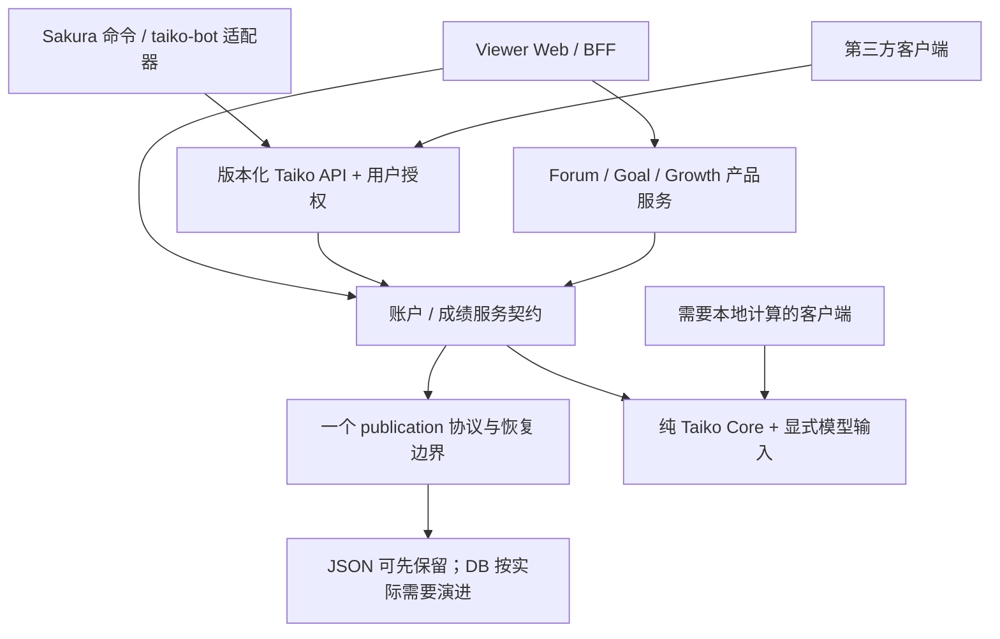

# ADR：Sakura Taiko 当前边界与 Taiko Core 可行性

日期：2026-10-10。状态：**PROPOSED — 审计建议，未批准迁移**。证据基线见 [Inventory](repository-inventory.md)，当前图见 [Data Flow](data-flow-map.md)。

## 1. Taiko Core 是否值得建立？

**CONDITIONAL。值得抽离纯领域计算，但不应在 1.0 前把整个 utils 搬成 Core。**

依据：两个 bot 的 53 个同路径文件中，10 个字节相同、718 个限定名称函数 AST 相同，重复函数覆盖 B 的 11,365 行。维护已不是理论成本：v2 精度公式、候选过滤、目标推荐模型、历史与每日测量路径存在真实分叉。Viewer 已经通过 Python bridge 复用其中一份，而没有一个可独立版本化的内核包。

限制：score_calculator 混合文件读取与可选绘图；utils 包初始化/NoneBot、硬编码路径、DB、token、模型文件及 Viewer v2 API 相互耦合。直接移动目录会把这些依赖一起带走，既不解除多 Writer，也不修复越权。

抽离前条件：

1. 冻结 ScoreRecord、ChartKey、来源/地区/单双打/重复版本、v1/v2、TopN 和输出版本契约。
2. 纯计算接收显式 records/catalog/model，不自行访问 DB、网络、用户文件、NoneBot 或全局密钥。
3. 使用合成/获授权脱敏样例建立各调用方一致性；记录有意差异，而不是强行把 v1/v2 或 Goal/推荐混成一个算法。
4. 明确正本、包版本和 model/data revision，支持只升级一个客户端；恢复路径也记录这些版本。

候选模块：Rating/六维/聚合、chart identity/availability、推荐候选及评分、可纯化的解析/规范化。排除：账户、授权、Writer、Forum、凭据、传输、图片布局，以及未冻结的 Growth 产品事实。后者由产品服务定义契约，再考虑复用。

## 2. Sakura_bot 是否继续拥有 taiko 代码？

| 选项 | 适配现状 | 决策 |
| --- | --- | --- |
| A：抽纯 taiko-core，Sakura_bot 与 taiko-bot 调用 | 能减少本地算法重复；不天然统一数据授权/写入 | **1.x 条件满足后推荐**；Sakura 继续拥有命令、适配器和渲染宿主 |
| B：Sakura_bot taiko 保留 + taiko-bot client | 改动最小；把 B 改成完全远程计算会增加中心负载和联网依赖 | **1.0 过渡形态**；当前 B 实际仍是混合，不应对外宣称已是纯 client |
| C：API-first Taiko Service | 最易统一对外数据授权和持久状态；独立部署是另一个决策 | **外部边界方向推荐**；先在现有部署内建立 service contract，不先拆新服务 |

建议组合：短期 B 的部署形态 + 修好的 API 边界；中期 A 的纯计算库 + C 的中心账户/成绩服务。Sakura_bot 不应永久成为其他产品直接导入的“任意业务 utils 仓库”，但无需删除全部 taiko 代码。

## 3. Viewer 是否应该直接访问底层数据？

**当前确实直接读写。未来浏览器/外部客户端不应直接访问；Viewer 服务端在 1.0 可保留受控 storage adapter。**

需要禁止的是多个服务随意解释文件布局、各写各的历史以及绕过 owner 的读取。短期统一 Writer/publication 和读取契约即可，不必为了调用一个同机文件而马上新增 HTTP hop。之后可把适配器放到单一数据服务；Web account、Forum、Goal 等自己的领域仍由对应服务负责。

不要把读取 C/H 的 TS 业务代码当成事实存储权威；也不要把 Python provenance hash 当成可对抗恶意 Writer 的签名。跨边界来源必须从授权生产者取得。

## 4. Developer API 是否应成为未来唯一外部入口？

**YES，指第三方访问平台私有成绩与平台能力的统一、版本化入口；不是现有 quota API 原样升格。**

未来入口应区分开发者身份与最终用户授权：client identity + 用户 grant + scopes + 资源 owner + 撤销/到期 + 配额。公共曲库/资源可继续匿名读取；Web session API、内部 bot service API 和上游 Wahlap/Hiroba 并不需要冒充同一种 Developer token。

保留已有 public-score token 的迁移兼容窗口，随后收敛授权契约；不能立即删掉所有旧入口或让开发者 token 自动访问所有用户。具体路径和版本设计留给获授权实施阶段。

## 推荐目标边界（仅建议）

## 路线选择和迁移优先级

**1.0 选择加强版路线 A；1.x 条件满足后路线 B；当前证据不足以要求路线 C 的全面大改。**

顺序：封授权与凭据控制面 → 统一 publication/恢复及运行清单 → 冻结身份/数据/模型契约 → 关闭 1.0 Gate → 抽纯计算并逐客户端采用 → 再按流量、并发 Writer 和查询需求判断 DB/Core Service。

加强版 A 不只是“保持 JSON、修 Writer”：还必须修敏感 API 边界。路线 B 的 Contract Freeze 应先于抽包；把所有成绩迁数据库并不会自动修 owner/scope、来源、模型和历史语义。

## 本次不作出的决定

不批准 Core 创建、代码移动、API 变更、Writer/DB 修改、数据迁移或部署；没有改版本。1.0 当前不能凭本报告直接放行，需取得 [风险图](platform-risk-map.md) 中的关闭证据。
