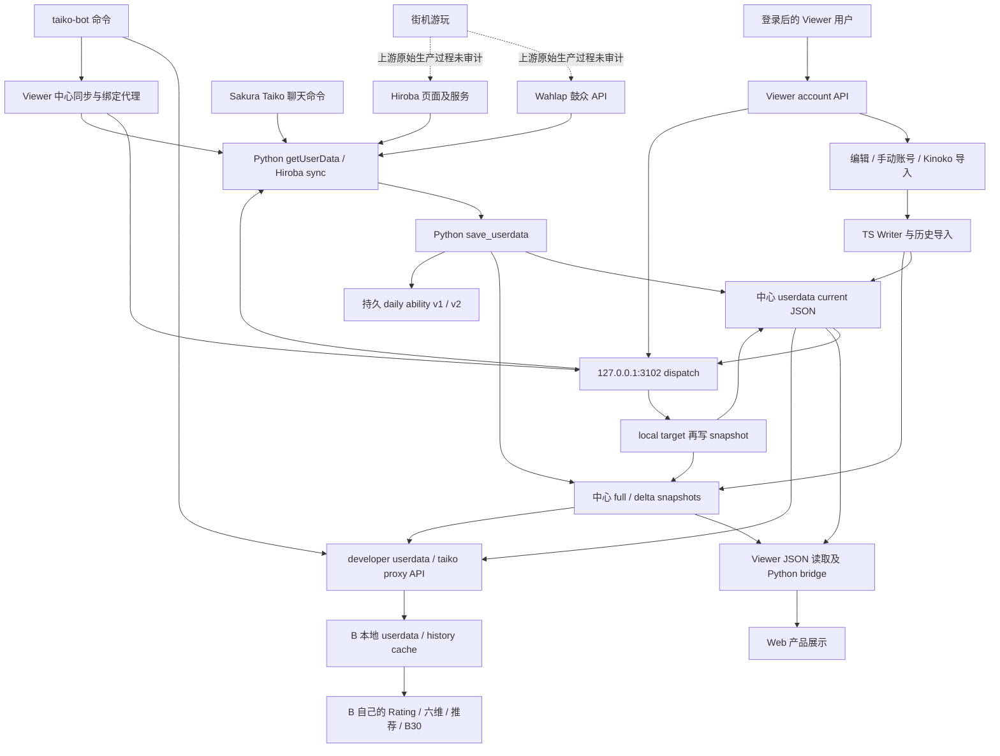
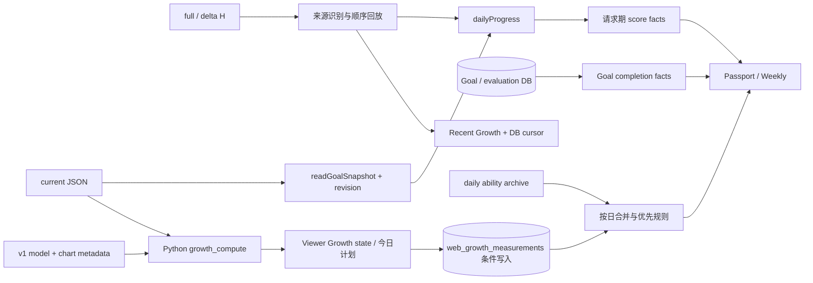
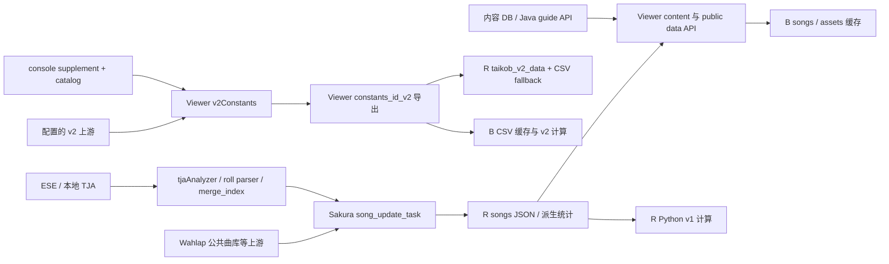
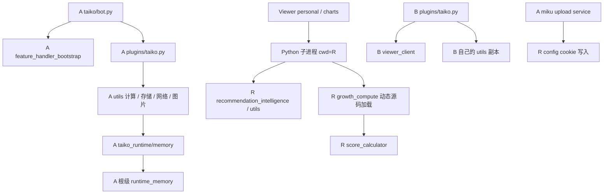

# 当前真实数据流

实线表示源码可追踪调用；R 的位置由 Viewer 进程环境和 service cwd 支持。**未执行线上业务调用，所以网络可达性、远端部署版本和实际数据内容不在本图的验证结论内。**

## 成绩、写入与消费

本图 `Dispatch → Pull` 仅对应 R 的当前磁盘实现；A 源码 dispatch 尚无该调用。`proxyTaikoCenterHirobaSync` 直接在 R 启动 Python，不经过 Wahlap dispatch。手动账户走受 bot service token 保护的 internal API，和一般 taiko proxy 是不同信任边界。[E05](evidence-index.md#e05)、[E06](evidence-index.md#e06)、[E11](evidence-index.md#e11)、[E31](evidence-index.md#e31)

## Growth 事实、测量与缓存

snapshot 是“观察到的状态”；measurement 是“当时的模型测量”；fact 是“依据证据推导的变化”。没有从原始街机完整 play log 到平台的已证实链。`GET growth/overview` 也可能保存 measurement；HTTP GET 不能自动当作只读探针。[E17](evidence-index.md#e17)、[E19](evidence-index.md#e19)、[E20](evidence-index.md#e20)

## 曲库、谱面和 v2 反向依赖

v2 上游 URL 默认 `https://cdn.ourtaiko.org/api/gugu_constants`，这是源码默认值，不宣称已确认运行时 override。Viewer 定数服务缓存 TTL 为 1h、最大 stale 7d；导出失败可退回中心本地 CSV。中心 Python 又通过 Viewer 读取 v2 数据，形成发布/可用性耦合。[E08](evidence-index.md#e08)、[E23](evidence-index.md#e23)、[E32](evidence-index.md#e32)

## import / 调用边界

[imports.csv](evidence/imports.csv) 收录静态 import，**不等价于完整动态调用图**；Python 包初始化、Nuxt 自动导入、字符串嵌入 Python、动态 importlib 已用上述关键链补充。没有证据证明存在独立 taiko-core 或统一 Taiko Service。
