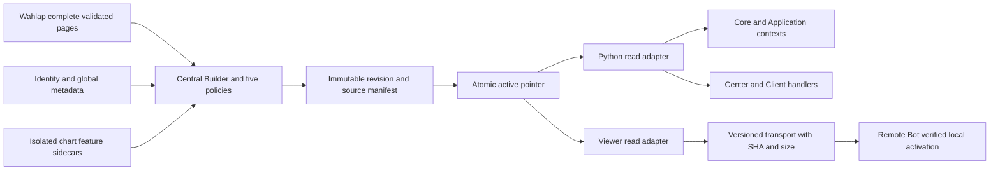

# Catalog Authority implementation and revision strategy

选择一个中央 Python Builder、版本化不可变 Snapshot，以及 Python/Node 只读适配层。Bot 的 catalog 包承载 Builder；独立 Core 保留纯领域计算，不依赖网络和运行目录。Application 使用注入的 Catalog context。远端 Bot 只接收中央决策，不重新构建国行策略。

实现目录：[Bot catalog](../../../bot/taiko_bot/catalog)、[Viewer read adapter](../../taiko_viewer/server/services/content/catalogAuthority.ts)、[HTTP scope plugin](../../taiko_viewer/server/plugins/catalog-revision.ts)。

| 项目 | 实现 |
|---|---|
| Schema Version | 1；不支持的 schema/policy 拒绝安装或读取 |
| Catalog Revision | 对确定序列化的完整逻辑主体求 SHA-256；包含来源、fetch time、Builder code identity、元数据、策略和 feature 状态；行级 stamp 在该 revision 确定后加入，最终字节另求 transport/storage SHA |
| Policy Version | wahlap-cn-1，随决策语义显式升级 |
| Source Revision | 官方语义 payload 的本地内容哈希，明确不是 server revision |
| Source Manifest | 分页查询、HTTP、fetch time、精确响应 hash/size；独立 metadata/model/coverage 文件 hash/size；无凭证 |
| Builder provenance | 实际安装包版本、catalog Python 文件哈希；验收构建还记录源码 commit |
| Immutable storage | revisions/<revision>/catalog.json + manifest.json；完整校验后保存，444，禁止同 revision 不同内容；没有可写 projection hardlink |
| Activation | 验证 manifest/schema/hash 后，临时文件 fsync、rename active.json、目录 fsync；追加 activation journal |
| Fetch failure | 仅写 stale/incomplete health；旧 active.json 不动，不从其他曲库回退 |
| Rollback | 校验已有兼容 revision 后切换 pointer；保留旧版本，不自动清理；不改玩家数据 |
| Consumer reporting | Viewer HTTP 三个 X-Catalog headers；Python View.report；Application context stamp；Bot health 中 active + 实际使用过的 handler revision/PV/time；UGC audit report |
| Request consistency | Viewer AsyncLocalStorage 包住整个 H3 handler；Bot ContextVar 懒捕获同一 generation；Python 子进程接收显式 root/revision；无目录需求的命令不被强制初始化 Catalog |
| Cache invalidation | Reader 最多 3 revisions；搜索索引、身份组、prepared rating、模型 fingerprint、annual fingerprint 及 goal receipt 输入包含 Catalog revision；独立模型文件仍有自身 revision |
| Remote distribution | Viewer manifest 给 revision/PV、传输 SHA/size 和 revision-bound URL；远端校验完整后安装/激活；manifest 与下载期间切换返回 409，保留 LKG 并重取 manifest |

位置分类成员也由同一官方响应冻结，已有位序索引只作参考顺序；Center/Client 不另读实时位序文件。历史身份继承已验证的 previous snapshot；旧元数据/legacy ID 缺失也保留历史行和 alias。前一代无法验证时拒绝建立新的身份宇宙。激活 journal 与保留的 revision 提供前后代关联。

所有单谱面异常隔离到该 coverage record。缺失 coverage sidecar 时 Catalog、搜索、历史、当前 CN 判定和已有模型推荐可以继续；分析特征 unavailable。缺失或哈希变化的 raw 文件只使对应分析输入失效，不推导国行下架。

内存中已验证 generation 按不可变约定使用；缓存命中复用已验证字节投影，不在每次查找重算大文件 hash。磁盘篡改在重新装载/切换时拒绝；不宣称每次内存查询重新监测磁盘。外部数据生产者不得原地改已激活文件。

中央生产者采用**单 writer 调度**。当前 atomic pointer 保证完整可见，不提供多个并发 Builder 的先后顺序仲裁；上线须确认现有 daily job 单实例锁。跨进程抢占/最后写入排序不能用现有测试虚报已解决。每个请求保证单版本；跨机器同时无版本差异需要部署协调及 health 监测，不作虚假全局事务承诺。

本批只在 `/var/tmp/taiko-batch21-20261124/catalog` 激活 QA Snapshot。原运行目录没有新 Catalog 激活，生产仍是原版本。发布验收后才可按独立流程配置同一中心 root 和远端同步，当前不执行部署。
